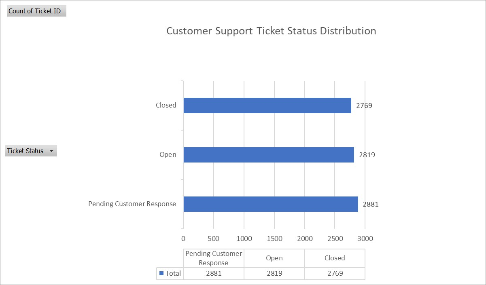

# 📊 Customer Support Performance Analysis

## 📌 Project Overview
This project analyzes customer support ticket data to evaluate support team performance, identify recurring customer issues, and understand ticket resolution efficiency.

The objective is to transform raw customer support data into meaningful business insights that can help improve operational efficiency and customer satisfaction.

## 🎯 Business Objectives
- Analyze customer support ticket trends.
- Evaluate ticket status and priority distribution.
- Identify common customer complaints and issues.
- Examine customer satisfaction ratings.
- Understand ticket resolution patterns.
- Identify opportunities for operational improvement.

## 📁 Dataset Description
The dataset contains **8,469 customer support records** with information such as:
- Customer details
- Product purchased
- Ticket type and priority
- Ticket status and resolution
- First response time
- Time to resolution
- Customer satisfaction rating

## 🛠️ Tools & Technologies
- **Microsoft Excel:** Data exploration, cleaning, and analysis.
- **SQL:** Querying and analyzing customer support data.

## 🔍 Analysis Performed
- Explored dataset structure and columns.
- Checked for duplicate records.
- Examined missing values.
- Analyzed ticket status distribution.
- Evaluated customer satisfaction ratings.
- Explored ticket categories and priorities.

## 📈 Key Business Questions
1. What are the most common customer support issues?
2. Which ticket statuses have the highest volume?
3. How efficiently are customer support tickets resolved?
4. How satisfied are customers with the support experience?
5. Which areas require operational improvement?

## 📊 Visualizations
### Ticket Status Distribution

## 💡 Business Insights
The analysis focuses on understanding ticket distribution, customer satisfaction, and resolution patterns to identify potential areas for improvement in customer support operations.

## 🚀 Future Scope
- Perform advanced SQL analysis.
- Develop an interactive Power BI dashboard.
- Conduct exploratory data analysis using Python.
- Generate actionable business recommendations.

## 👩‍💻 Author

**Isha Roy**

Aspiring Data Analyst | Excel | SQL | Business Analytics

